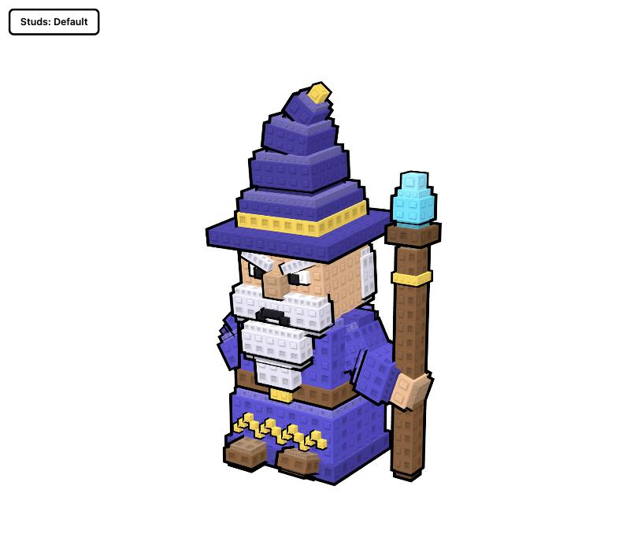
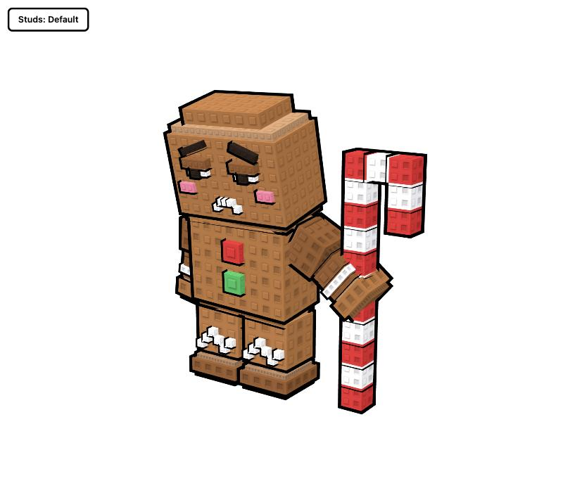
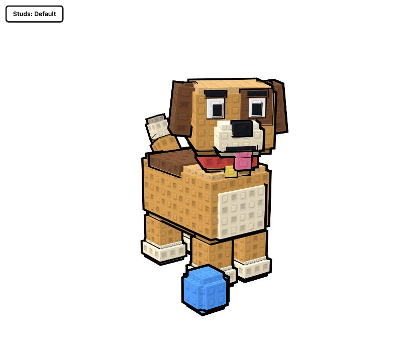
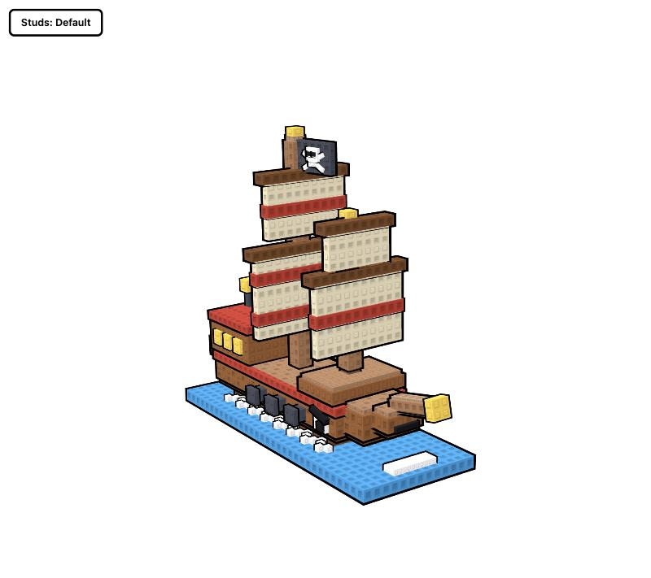

# Stud style (Toon voxel brick)

A Claude skill that turns a short prompt into a 3D model in the "Toon voxel brick" style: chunky toy proportions, everything built from boxes, square studs on every face, and a thick black cartoon outline. Close to classic Roblox and toy-brick figures.

You do not describe the style in your prompt. Type `/stud-style` followed by what you want, and the skill supplies the rest:

```
/stud-style make me a grumpy wizard
```

## Examples

Each model below came from the prompt shown and nothing else, in a single attempt with no follow-up. Open the `.html` file to orbit the live model.

| Prompt | Result |
|---|---|
| `make me a grumpy wizard` | [](examples/wizard.html) |
| `tired gingerbread man holding a candy cane` | [](examples/gingerbread.html) |
| `a dog` | [](examples/dog.html) |
| `a pirate ship` | [](examples/pirate-ship.html) |

### Which model

All four examples were generated by **Claude Fable 5.2** (`claude-fable-5-2`).

In Claude Design, pick Claude Fable 5.2 in the model picker to match these results. Other models can use the skill, but have not been tried.

The skill has been confirmed to run in Claude Design with Fable 5.2 when called as `/stud-style <what to make>`. Without the command, Claude Design's 3D object mode uses its own smooth-shaded starter and ignores the skill.

How the examples were made, so you know what they do and do not show: each one was produced by a fresh Claude Fable 5.2 agent that was given only this skill and the prompt. The agent could not preview its work or ask questions. They were run as agent trials, not inside Claude Design itself, so results in Claude Design may differ. They were made with version 1.0 of the skill; version 1.1 adds the second stud variant and the outline fix listed below.

## Install

1. Download `stud-style.skill` from the [latest release](https://github.com/rasptum/toon-voxel-brick-skill/releases/latest).
2. Add it to Claude as a skill (in Claude, open the file and choose **Save skill**, or upload it in your skills settings).
3. Call it with any object. For example: `/stud-style a sleepy dragon`, `/stud-style a food truck`, `/stud-style my cat, orange and fat`.

If you installed the earlier `toon-voxel-brick` skill, remove it so the two do not compete.

## What you get

A single self-contained HTML page with a live three.js scene:

- drag to orbit, scroll to zoom
- a **Studs: Default / HD** button (HD doubles the stud count)
- an idle animation with one personality beat
- a white background, unless you ask for another colour

## The style rules, in short

1. **Boxes only.** No spheres, cylinders or bevels. Curves become stepped staircases.
2. **Chunky toy proportions.** Big heads, thick limbs, exaggerated identifying features.
3. **Small flat palette.** Three to five base colours plus pure accents. Shading is baked in as a lighter slab on top of each block and a darker one below.
4. **Square studs on every face, in two variants.** A filled stud (solid raised square) and a hollow stud (raised square rim with a sunk centre), at the same world size on every block. Five patterns arrange the two: solid, hollow, checker, rows and columns. Each area of a model gets its own pattern.
5. **Raised detail.** Faces, trims and patterns are small boxes on the surface, never painted on.
6. **Black outline on every piece.** An inverted-hull rim, so every step and joint gets a line. The outline is depth-biased so it does not flicker against the surfaces it touches.
7. **No gaps at joints.** Every rotating part uses an overlapping, filled joint, so no pose opens a see-through gap.
8. **One idea per model.** One emotion or one piece of story, shown in the pose.
9. **Rigid animation.** Rotations only, slow wind-up and fast strike, tumbling cubes for effects.

The full rules are in [`stud-style/SKILL.md`](stud-style/SKILL.md).

## What is in this repo

| Path | What it is |
|---|---|
| `stud-style.skill` | The packaged skill, ready to install |
| `stud-style/SKILL.md` | The skill's instructions, with the helper kit and worked example embedded at the end so the skill works where attached files are not available |
| `stud-style/assets/brickkit.js` | three.js helper kit: studs, bevel slabs, outlines, gap-proof joints, auto-framing camera |
| `stud-style/assets/example-scene.js` | A short worked example (a sleepy potted cactus) |
| `examples/` | The four prompt-to-model examples above, with screenshots |

## Notes

- The stud textures are generated in code by the kit. No third-party texture files are included.
- Scenes load three.js r128 from cdnjs, so they need an internet connection to display.
